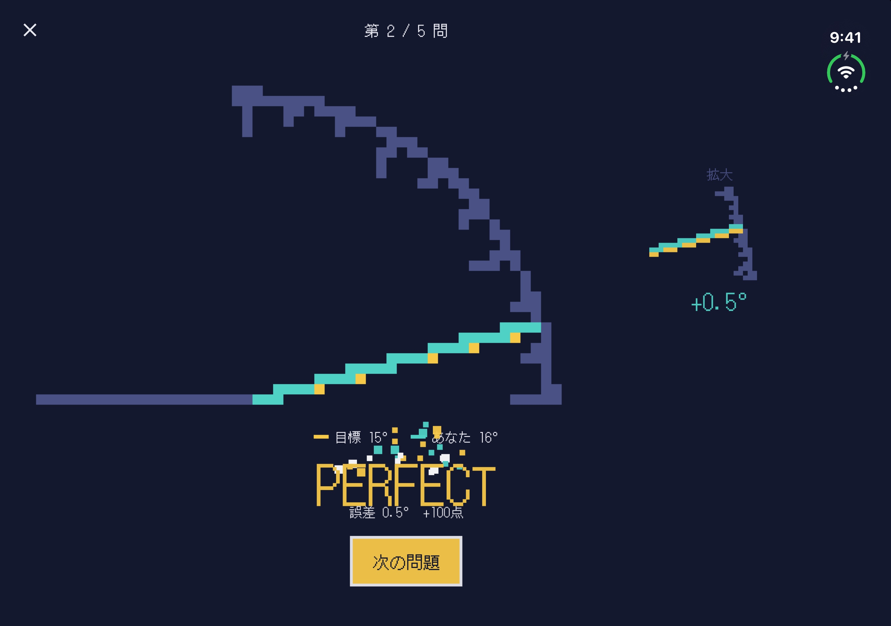

# ピタッとアングル (Angle Sense)

[English](README.md) | 日本語

折りたたみ iPhone（iPhone Duo）向けのパーティーゲームです。Flutter 3.50 で作っています。
自分の感覚と人の感覚は、思ったよりズレている。お題の角度を覚えて、画面が暗くなったら感覚だけで折り曲げます。

[](screenshots/iphone_duo_inner/)

[App Store でダウンロード](https://apps.apple.com/jp/app/id6831511794)

## あそびかた

1. 画面にお題の角度が出ます（平らが 0°、直角が 90°）。
2. 数秒たつと画面が暗くなります。
3. 見えないまま、感覚だけでお題の角度まで本体を折り曲げて止めます。
4. 答え合わせ。ズレが小さいほど高得点です。

モードは **ひとりで**（5 問・自己ベスト）と **バトル**（2〜10 人で 1 台を回す）の 2 つです。
iPhone Duo ではヒンジが操作になり、そのほかの iPhone では横向きにして傾けて遊びます。
iOS 15 以降で動き、ヒンジでの操作には iOS 27.1 以降が必要です。

## 技術の見どころ

iOS 専用の API を、プラットフォームチャネルを手書きせずに Flutter 3.50 から呼ぶ実例として公開しています。

| 内容 | 方法 | 場所 |
| --- | --- | --- |
| ヒンジの角度（`UIHingeInteraction`・iOS 27.1+） | **FFIgen** で生成した Objective-C バインディングを Dart から直接呼ぶ。コールバックは listener ブロック。`UIApplication.connectedScenes` から Flutter のビューを探して付ける | [`packages/device_angle/lib/src/hinge.dart`](packages/device_angle/lib/src/hinge.dart) |
| 本体の傾き（`CMMotionManager`） | FFIgen のバインディングを Dart から定期的に読む（`sensors_plus` は使わない） | [`packages/device_angle/lib/src/tilt.dart`](packages/device_angle/lib/src/tilt.dart) |
| バインディングの生成 | Dart で書く FFIgen の設定。使うクラスとメソッドだけを列挙 | [`packages/device_angle/tool/ffigen.dart`](packages/device_angle/tool/ffigen.dart) |
| ネイティブ部分のビルド | **ビルドフック**（`hook/build.dart`・`native_toolchain_c`）で、生成された Objective-C を iOS 向けにだけビルド | [`packages/device_angle/hook/build.dart`](packages/device_angle/hook/build.dart) |
| App Store のレビュー依頼 | StoreKit 2 の `AppStore.requestReview(in:)` は Swift 専用のため、ローカルの Swift Package Manager プラグインを **Pigeon** のホスト API 経由で呼ぶ | [`packages/store_review/`](packages/store_review/) |

そのほか:

- `material_ui` / `cupertino_ui` パッケージ（3.50 でのデザインライブラリの分離）
- [pedantic_mono](https://pub.dev/packages/pedantic_mono) の lint ＋ strict-casts / strict-inference / strict-raw-types、primary constructor
- MVVM（`GameViewModel`）、sealed な `Result` を返すリポジトリ、色の `ThemeExtension`
- gen-l10n による多言語対応（日本語・英語。それ以外の端末言語は英語）
- アクセシビリティ: VoiceOver の読み上げ、文字サイズ 2 倍での表示、視差効果を減らす設定への対応
- `lib/` と同じ構成の 200 件以上のウィジェットテスト・単体テスト

コード中のコメントは日本語です。

## ビルド

必要なもの: macOS と Xcode 27.1 以降（iOS 27.1 SDK）、[FVM](https://fvm.app/)（Flutter のバージョンは `.fvmrc` で固定）。

```bash
fvm install
fvm flutter pub get
fvm flutter test
fvm flutter run
```

シミュレータにはヒンジも傾きのセンサーもありません。シミュレータで遊ぶときは撮影用の角度入力を使い、表示されたファイルに角度（度）を書き込みます。

```bash
fvm flutter run --dart-define=DEMO_ANGLE=hinge
```

バインディングの再生成: `cd packages/device_angle && fvm dart run tool/ffigen.dart`
Pigeon のコードの再生成: `cd packages/store_review && fvm dart run pigeon --input pigeon/messages.dart`

`tool/release_testflight.sh` は App Store Connect の API キーでビルドをアップロードします。キー ID と Issuer ID は `tool/asc.env`（リポジトリには含めない）から読みます。

## ライセンス

ソースコードは [MIT License](LICENSE) で公開しています。

- アプリ名「ピタッとアングル」「Angle Sense」とアプリのアイコンは、MIT License の対象外です。ご自身でビルドを公開する場合は、別の名前とアイコンを使ってください。
- フォント: [DotGothic16](https://fonts.google.com/specimen/DotGothic16)、SIL Open Font License 1.1（[`assets/fonts/OFL_DotGothic16.txt`](assets/fonts/OFL_DotGothic16.txt)）
- 効果音は [`tool/gen_sfx.py`](tool/gen_sfx.py) で生成したもので、MIT License の対象です。
