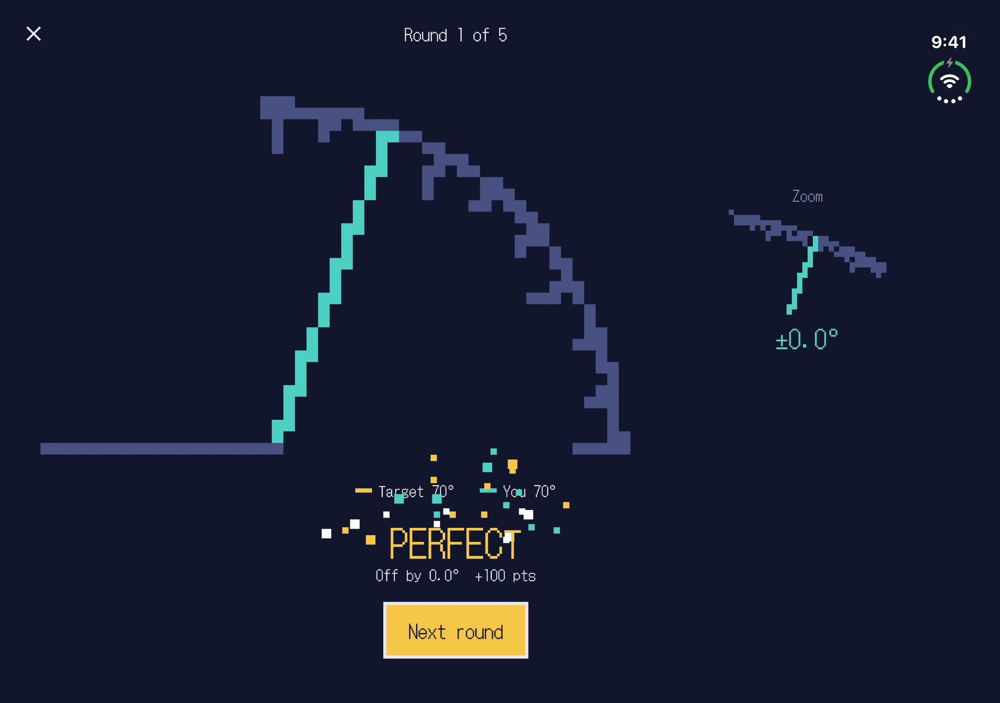

# Angle Sense (ピタッとアングル)

English | [日本語](README.ja.md)

A party game for the foldable iPhone (iPhone Duo), built with Flutter 3.50.
Your sense of an angle is not the same as everyone else's — memorize a target
angle, then fold the phone to it in the dark.

[](screenshots/iphone_duo_inner_en/)

[Download on the App Store](https://apps.apple.com/app/id6831511794)

## How to play

1. A target angle appears (flat is 0°, a right angle is 90°).
2. After a few seconds the screen goes dark.
3. Without looking, fold the device to the target angle and hold it.
4. Reveal: the smaller the gap, the higher the score.

Modes: **Solo** (5 rounds, personal best) and **Battle** (2–10 players pass one
device around). On the iPhone Duo the hinge is the controller; on other iPhones
you tilt the phone in landscape instead.
Runs on iOS 15 or later; the hinge input needs iOS 27.1 or later.

## Technical highlights

This repository is meant as a working example of calling iOS-only APIs from
Flutter 3.50 without hand-written platform channels.

| What | How | Where |
| --- | --- | --- |
| Hinge angle (`UIHingeInteraction`, iOS 27.1+) | **FFIgen** Objective-C bindings, called directly from Dart. The callback is a listener block; the observer is attached to the Flutter view found through `UIApplication.connectedScenes` | [`packages/device_angle/lib/src/hinge.dart`](packages/device_angle/lib/src/hinge.dart) |
| Device tilt (`CMMotionManager`) | FFIgen bindings, polled from Dart (no `sensors_plus`) | [`packages/device_angle/lib/src/tilt.dart`](packages/device_angle/lib/src/tilt.dart) |
| Binding generation | Dart-config FFIgen with an allow-list of classes and methods | [`packages/device_angle/tool/ffigen.dart`](packages/device_angle/tool/ffigen.dart) |
| Native glue build | **Build hook** (`hook/build.dart`, `native_toolchain_c`) compiles the generated Objective-C for iOS only | [`packages/device_angle/hook/build.dart`](packages/device_angle/hook/build.dart) |
| App Store review prompt | StoreKit 2 `AppStore.requestReview(in:)` is Swift-only, so it is called through a **Pigeon** host API in a local Swift Package Manager plugin | [`packages/store_review/`](packages/store_review/) |

Other things you can find here:

- `material_ui` / `cupertino_ui` packages (the 3.50 split of the design libraries)
- [pedantic_mono](https://pub.dev/packages/pedantic_mono) lints with strict casts, inference and raw types; primary constructors
- MVVM (`GameViewModel`), a repository returning a sealed `Result`, a `ThemeExtension` for colors
- Localization with gen-l10n (Japanese and English; any other device language falls back to English)
- Accessibility: VoiceOver labels, 2× text scale layouts, reduce motion
- 200+ widget and unit tests mirroring `lib/`

Code comments are in Japanese.

## Build

Requirements: macOS with Xcode 27.1+ (iOS 27.1 SDK), and [FVM](https://fvm.app/)
(the Flutter version is pinned in `.fvmrc`).

```bash
fvm install
fvm flutter pub get
fvm flutter test
fvm flutter run
```

The simulator has no hinge or motion sensor. To try the game there, use the demo
angle source and write an angle (in degrees) into the file path it prints:

```bash
fvm flutter run --dart-define=DEMO_ANGLE=hinge
```

To regenerate the bindings: `cd packages/device_angle && fvm dart run tool/ffigen.dart`.
To regenerate the Pigeon code: `cd packages/store_review && fvm dart run pigeon --input pigeon/messages.dart`.

`tool/release_testflight.sh` uploads a build with an App Store Connect API key;
the key ID and issuer ID are read from `tool/asc.env` (not in the repository).

## License

The source code is released under the [MIT License](LICENSE).

- The app name "Angle Sense" / "ピタッとアングル" and the app icon are **not**
  covered by the MIT License. Please use a different name and icon if you
  publish your own build.
- Font: [DotGothic16](https://fonts.google.com/specimen/DotGothic16), SIL Open
  Font License 1.1 ([`assets/fonts/OFL_DotGothic16.txt`](assets/fonts/OFL_DotGothic16.txt)).
- Sound effects are generated by [`tool/gen_sfx.py`](tool/gen_sfx.py) and are
  covered by the MIT License.
